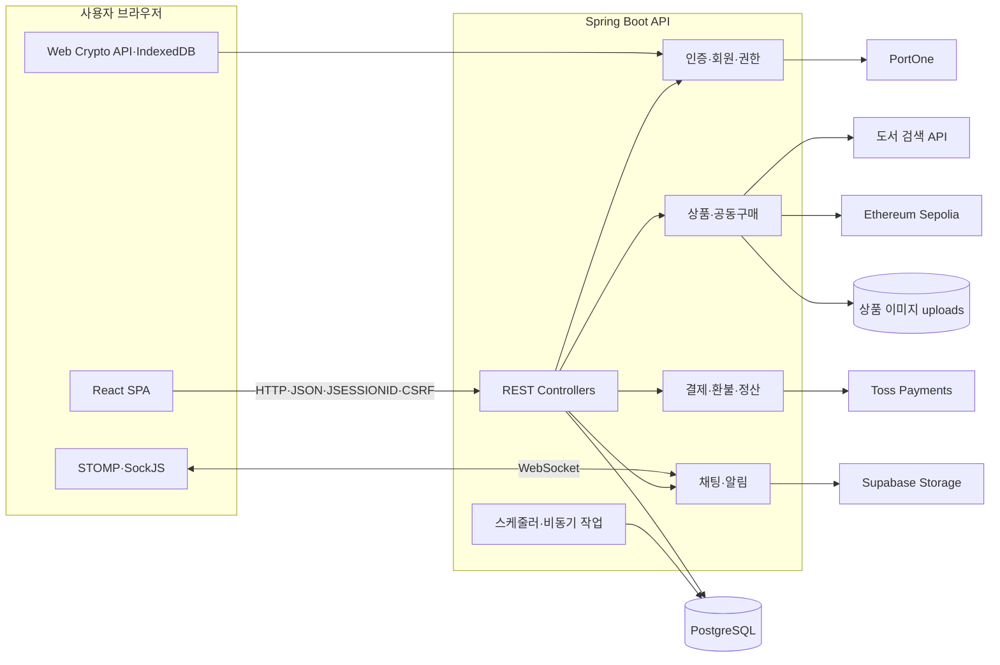

# N-BBANG

본인·기기 인증, 결제 상태 검증, 동시성 제어, 상품 정보 해시 검증을 결합한 대학 캠퍼스 공동구매 플랫폼입니다.

N-BBANG은 공동구매 과정에서 발생할 수 있는 다중 계정, 상품 정보 변경, 정원 초과 참여, 결제 승인 후 참여 확정 실패 문제를 줄이는 것을 목표로 합니다. 현재 저장소는 React SPA와 Spring Boot 단일 애플리케이션으로 구성된 졸업작품 및 PoC 단계의 프로젝트입니다.

## 1. 프로젝트 개요

일반 중고거래나 익명 커뮤니티에서 공동구매를 진행하면 참여자는 판매자의 신원, 상품 정보 변경 여부, 결제 이후 처리 상태를 확인하기 어렵습니다. N-BBANG은 다음 방식을 사용해 검증 가능성을 높입니다.

- PortOne 본인인증 결과의 CI를 이용한 활성 중복 계정 차단
- Web Crypto API와 X.509 인증서를 이용한 기기 개인키 보유 확인
- Toss Payments 승인 결과와 서버 결제 상태 대조
- 비관적 락을 이용한 공동구매 정원 초과 방지
- 상품 ID, ISBN, 가격의 SHA-256 해시를 Sepolia에 기록하고 DB 값과 비교
- 상품·채팅 신고, 보안 로그, 관리자 승인 및 모니터링

PortOne은 본인인증에 사용하고 Toss Payments는 결제에 사용합니다. 결제 상태 검증과 블록체인 상품 해시 검증은 서로 독립된 흐름입니다.

## 2. 주요 기능

| 영역 | 구현 내용 |
| --- | --- |
| 인증·계정 | PortOne 본인인증, CI 중복 검사, BCrypt 비밀번호, X.509 기기 인증서, RSA-OAEP 챌린지, 세션 로그인 |
| 상품·공동구매 | 판매자 승인, 상품 등록·수정·삭제, 참여·취소, 스크랩, 정원 및 마감 관리 |
| 결제·환불·정산 | Toss 결제 준비·승인·조회·취소, 참여 실패 보상 환불, 종료 공구 환불 스케줄러, 판매자 정산·출금 |
| 상품 무결성 | 상품 핵심 값 해시 생성, Ethereum Sepolia 비동기 기록, 온체인 해시와 DB 값 비교 |
| 검색·분석 | Naver·Kakao·Google 도서 검색, 도서 정가 보조 검증, 학과별 관심 도서 리포트 |
| 커뮤니케이션 | STOMP/SockJS 기반 1:1 채팅, 읽지 않은 메시지 수, 알림, 채팅 이미지 업로드 |
| 운영 | 후기, 문의·답변, 상품·채팅 신고, 판매자 통계, 관리자 대시보드, 보안 로그·시뮬레이션 |

## 3. 기술 스택

| 구분 | 기술 |
| --- | --- |
| Frontend | React 19.2.6, React Router DOM 6.30.1, Tailwind CSS 3.4.19, PostCSS |
| Frontend Test | Jest, React Testing Library, jest-dom |
| Backend | Java 17, Spring Boot 4.0.6, Spring MVC, Spring WebFlux WebClient |
| Data | Spring Data JPA, PostgreSQL 17, H2 Test Database |
| Security | Spring Security, HTTP Session, CSRF, BCrypt, Web Crypto API, BouncyCastle, X.509 |
| Realtime | Spring WebSocket, STOMP, SockJS |
| Payment·Identity | Toss Payments, PortOne |
| Blockchain | Web3j 4.10.0, Solidity, Ethereum Sepolia |
| Storage | 로컬 `uploads` 상품 이미지, Supabase Storage 채팅 이미지 |
| Infrastructure | Docker, Docker Compose, Vercel, Render, GitHub Actions |

## 4. 시스템 구조

N-BBANG 백엔드는 도메인 패키지로 책임을 나눈 계층형 모놀리스입니다. 각 도메인은 하나의 Spring Boot 프로세스와 데이터베이스, 트랜잭션 경계를 공유합니다.



### 인증과 요청 보안

1. 회원가입 시 PortOne 본인인증 결과를 서버가 다시 조회하고 CI 중복 여부를 검사합니다.
2. 브라우저는 RSA-OAEP 키 쌍을 만들고 개인키를 IndexedDB에 저장합니다.
3. 로그인 시 서버가 기기 공개키로 암호화한 nonce를 발급하고, 브라우저가 개인키로 복호화해 키 보유를 증명합니다.
4. 로그인 상태는 `JSESSIONID`로 유지하고, `AuthInterceptor`와 `AdminAuthInterceptor`가 API 및 관리자 권한을 검사합니다.
5. SPA는 `/api/csrf`에서 토큰을 받은 뒤 상태 변경 요청의 `X-XSRF-TOKEN` 헤더에 포함합니다.

### 결제와 동시성 제어

1. 서버가 상품 가격, 정원, 마감, 중복 참여 여부를 검사하고 `PENDING` 결제를 생성합니다.
2. Toss Payments 승인 후 실제 주문 상태와 금액을 서버에서 확인합니다.
3. `PESSIMISTIC_WRITE` 락으로 상품 참여 확정을 직렬화해 정원 초과를 방지합니다.
4. 참여 확정이 실패하면 결제를 `CANCEL_REQUESTED`로 전환하고 Toss 취소를 요청합니다.
5. 환불 결과를 `CANCELED` 또는 `REFUND_FAILED`로 기록하며, 종료된 공동구매의 미처리 결제는 스케줄러가 점검합니다.

```text
PENDING -> APPROVED -> DONE
                  \-> CANCEL_REQUESTED -> CANCELED
                                      \-> REFUND_FAILED
```

### 상품 정보 무결성 검증

상품 등록 트랜잭션이 완료되면 `productId + ISBN + price`의 SHA-256 해시를 비동기로 Sepolia 스마트 컨트랙트에 기록합니다. 상품 상세 검증 API는 DB 현재값으로 계산한 해시와 컨트랙트의 현재 해시를 비교합니다. 결제 영수증, 참여 인원, 채팅 및 배송 정보는 해시 범위에 포함되지 않습니다.

### 실시간 채팅과 배치 작업

- 채팅은 STOMP/SockJS와 Spring의 simple broker를 사용합니다.
- 채팅 메시지와 읽음 상태는 PostgreSQL에 저장합니다.
- 채팅 이미지는 Supabase Storage에 저장하고 상품 이미지는 백엔드의 `uploads` 디렉터리에 저장합니다.
- 환불·정산과 학과별 관심 도서 수집 작업은 Spring Scheduler로 실행합니다.

## 5. 프로젝트 구조

```text
yuhan_final_project/
├─ frontend/                    React SPA
│  ├─ public/
│  └─ src/
│     ├─ components/            공통·권한·레이아웃 컴포넌트
│     ├─ config/                API·WebSocket 주소 설정
│     ├─ contexts/              세션·알림·인증서 상태
│     ├─ pages/                 구매자·판매자·관리자 화면
│     └─ utils/                 API 요청·검증 유틸리티
├─ backend/                     Spring Boot 애플리케이션
│  ├─ src/main/java/.../
│  │  ├─ domain/                업무 도메인별 controller/service/repository
│  │  └─ global/                보안·예외·공통 설정
│  ├─ src/main/resources/       프로필 설정·Solidity 계약·키워드 설정
│  └─ src/test/                 백엔드 테스트
├─ document/                    문제 정의·요구사항·설계·배포 문서
├─ requirements/                보안·외부 API 요구사항
├─ legacy_code/                 초기 실험 및 참고 구현
├─ compose.yaml                 PostgreSQL·백엔드 로컬 구성
├─ render.yaml                  Render 백엔드·DB Blueprint
└─ vercel.json                  Vercel 프런트엔드 빌드 설정
```

## 6. 로컬 실행

### 사전 요구사항

- Java 17
- Node.js 22와 npm
- Docker Desktop 및 Docker Compose
- 사용하는 기능에 필요한 PortOne, Toss Payments, 검색 API, Supabase, Sepolia 설정값

### 환경 변수

예제 파일을 복사한 뒤 실제 로컬 개발값을 입력합니다. `.env`와 `.env.local`은 커밋하지 않습니다.

```powershell
Copy-Item backend\.env.example backend\.env
Copy-Item frontend\.env.example frontend\.env.local
```

프런트엔드의 기본 연결 주소는 다음과 같습니다.

```env
REACT_APP_API_BASE_URL=http://localhost:8080
REACT_APP_WS_URL=http://localhost:8080/ws
REACT_APP_TOSS_CLIENT_KEY=change-me
```

백엔드 환경 변수는 [backend/.env.example](backend/.env.example)에서 확인할 수 있습니다. 주요 그룹은 다음과 같습니다.

| 그룹 | 변수 |
| --- | --- |
| 데이터베이스 | `DB_URL`, `DB_USERNAME`, `DB_PASSWORD` |
| 애플리케이션 | `FRONTEND_ORIGIN`, `BACKEND_PUBLIC_URL`, `PKI_SERVER_SECRET` |
| 본인인증·결제 | `PORTONE_API_SECRET`, `TOSS_SECRET_KEY` |
| 도서 검색 | `NAVER_CLIENT_ID`, `NAVER_CLIENT_SECRET`, `ALADIN_TTB_KEY`, `KAKAO_REST_API_KEY`, `GOOGLE_BOOKS_API_KEY` |
| 블록체인 | `BLOCKCHAIN_URL`, `BLOCKCHAIN_PRIVATE_KEY`, `BLOCKCHAIN_CONTRACT_ADDRESS` |
| 채팅 이미지 | `SUPABASE_URL`, `SUPABASE_SERVICE_KEY` |

### Docker로 데이터베이스와 백엔드 실행

프로젝트 루트에서 실행합니다.

```powershell
docker compose up --build -d
docker compose ps
Invoke-RestMethod http://localhost:8080/actuator/health/readiness
```

정상 응답은 `{"status":"UP"}`입니다. 종료할 때는 데이터 볼륨을 보존하는 다음 명령을 사용합니다.

```powershell
docker compose down
```

### 프런트엔드 실행

```powershell
Set-Location frontend
npm ci
npm start
```

브라우저에서 `http://localhost:3000`에 접속합니다.

### 백엔드 직접 실행

PostgreSQL과 `backend/.env` 설정이 준비된 상태에서 실행합니다.

```powershell
Set-Location backend
.\gradlew.bat bootRun
```

macOS와 Linux에서는 `./gradlew bootRun`을 사용합니다.

## 7. 테스트와 빌드

### 프런트엔드

```powershell
Set-Location frontend
npm ci
npm test -- --watchAll=false
npm run build
```

### 백엔드

Java 17 환경에서 실행합니다.

```powershell
Set-Location backend
.\gradlew.bat test
.\gradlew.bat bootJar
```

macOS와 Linux에서는 다음 명령을 사용합니다.

```bash
cd backend
./gradlew test bootJar
```

### CI

GitHub Actions는 push와 pull request에서 다음 작업을 수행합니다.

- 프런트엔드 의존성 설치, 테스트, production build
- 백엔드 테스트와 `bootJar` 생성
- 백엔드 Docker 이미지 build

## 8. 배포 구성

| 대상 | 설정 |
| --- | --- |
| Frontend | 루트 `vercel.json`을 이용한 Vercel 정적 배포 |
| Backend | `backend/Dockerfile`을 이용한 Render Docker Web Service |
| Database | `render.yaml`의 PostgreSQL 17 Blueprint |
| Health Check | `/actuator/health/readiness` |

프런트엔드와 백엔드를 다른 도메인에 배포할 때는 백엔드의 `FRONTEND_ORIGIN`, 프런트엔드의 `REACT_APP_API_BASE_URL`·`REACT_APP_WS_URL`, 세션 쿠키의 `SameSite`·`Secure` 설정을 함께 맞춰야 합니다. 구체적인 절차는 [배포 인수인계 문서](document/07_DEPLOYMENT_HANDOFF.md)를 참고합니다.

## 9. 문제 해결 방식

| 문제 | 적용 방식 |
| --- | --- |
| 마지막 자리에 여러 사용자가 동시에 참여 | 상품 조회에 비관적 쓰기 락을 적용해 정원 확인과 참여 갱신을 직렬화 |
| 결제 승인 후 참여 확정 실패 | 결제 상태 머신과 보상 취소를 적용하고 실패 상태를 저장해 후속 처리 가능하도록 구성 |
| 상품 정보 변경 여부 확인 어려움 | 상품 핵심 값의 해시를 Sepolia에 기록하고 DB 현재값과 비교 |
| SPA와 API의 교차 출처 세션 요청 | 자격증명 CORS, 세션 쿠키 속성, CSRF 쿠키·헤더 검증을 함께 적용 |
| 외부 API 및 블록체인 응답 지연 | WebClient timeout, 비동기 기록, 오류 유형별 재시도와 상태 로그 적용 |

## 10. 현재 한계

- 브라우저 개인키는 IndexedDB에 저장되며 하드웨어 보안 영역에 귀속되지 않습니다.
- Root CA 키와 인증서 폐기 목록은 메모리 기반이므로 서버 재시작 후 유지되지 않는 PoC 구조입니다.
- 현재 스마트 컨트랙트의 해시 기록 함수에는 호출자 권한 제한이 없고 같은 상품 ID의 값을 덮어쓸 수 있습니다.
- 상품 이미지는 로컬 `uploads`에 저장되어 영속 디스크가 없는 배포 환경에서는 유지되지 않을 수 있습니다.
- HTTP Session, simple WebSocket broker, 인스턴스별 Scheduler를 사용하므로 현재 구성은 백엔드 단일 인스턴스를 전제로 합니다.
- Sepolia는 테스트넷이며 실제 운영 환경의 비용·성능·가용성을 대표하지 않습니다.

## 11. 문서

- [문제 정의와 범위](document/01_Problem_Definition.md)
- [요구사항](document/02_Requirements.md)
- [상세 설계](document/03_Design.md)
- [아키텍처](document/04_Architecture.md)
- [구현 및 형상 관리](document/05_Implementation.md)
- [배포 준비 점검](document/06_Deployment_Readiness.md)
- [배포 인수인계](document/07_DEPLOYMENT_HANDOFF.md)
