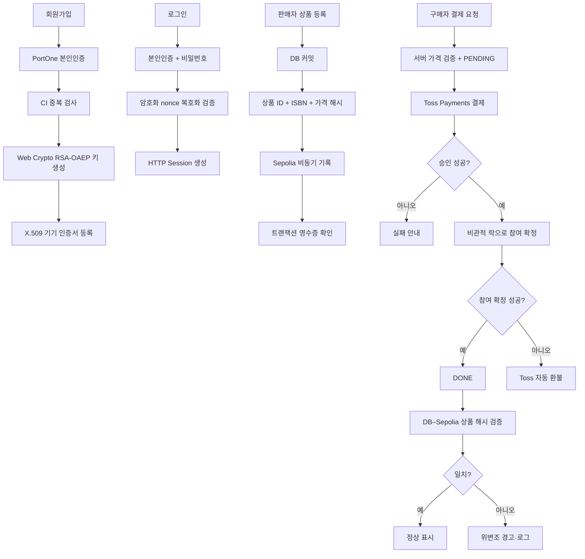

# 01. 문제 정의 및 프로젝트 범위 (Problem Definition & Scope)

- 문서 기준일: 2026-10-21
- 상태 표시: `구현 완료`, `부분 구현`, `계획`, `미검증`

## 1. 프로젝트 배경과 해결할 문제

대학 캠퍼스의 전공 서적·IT 기기 공동구매는 일반 중고거래 또는 익명 커뮤니티 플랫폼에서 진행될 수 있다. 이 경우 다음 위험을 사전에 확인하기 어렵다.

- 동일인의 다중 계정 사용 및 탈퇴 후 재가입
- 판매자·상품 정보의 임의 변경과 변경 이력 추적 부족
- 결제 승인 후 참여 확정이 실패하는 분산 트랜잭션 문제
- 목표 인원에 근접한 공동구매에 동시 참여가 발생할 때의 초과 확정
- 신고 이후에만 대응하는 사후 처리 중심 운영

N-bbang은 본인인증·기기 인증, 서버 기준 결제 검증, 동시성 제어, 상품 핵심 데이터의 온체인 해시 기록을 결합해 이 위험을 줄이는 캠퍼스 공동구매 플랫폼을 목표로 한다.

> “사기 원천 차단”이나 “사기율 0%”는 현재 실측된 성과가 아니다. 현 단계의 정확한 표현은 **신원·기기·결제·상품 정보의 검증 가능성을 높여 사기 위험을 감소시킨다**는 것이다.

## 2. 현재 해결 전략

| 영역 | 현재 구현 | 상태 |
|---|---|---|
| 본인 확인 | PortOne 본인인증 결과의 CI를 HMAC-SHA256으로 처리해 활성 중복 계정을 차단 | 구현 완료 |
| 기기 인증 | Web Crypto API로 RSA-OAEP 키 쌍을 생성하고, 서버가 공개키로 암호화한 nonce를 기기 개인키로 복호화해 보유를 증명 | 구현 완료(PoC) |
| 결제 | Toss Payments 결제 준비·승인·조회·취소, 서버 가격 재계산, 실패 시 자동 환불 Saga | 구현 완료 |
| 동시성 | `PESSIMISTIC_WRITE`로 참여 인원 갱신을 직렬화 | 구현 완료 |
| 상품 무결성 | `productId + ISBN + price`의 SHA-256 해시를 Sepolia 스마트 컨트랙트에 비동기 기록하고 DB 현재값과 비교 | 구현 완료(PoC) |
| 시세 보조 판단 | 외부 도서 API에서 공식 정가를 조회해 등록 가격을 비교 | 부분 구현 |
| 사후 대응 | 상품/채팅 신고, 시스템 로그, 관리자 모니터링 | 구현 완료 |

PortOne은 **결제사가 아니라 본인인증 수단**으로 사용한다. 결제 데이터와 블록체인 해시를 하나의 3중 검증 흐름으로 비교하지 않으며, 다음의 두 검증을 분리해 수행한다.

1. 로컬 `PAYMENT` 상태 ↔ Toss Payments 실제 결제 상태 대조
2. DB 상품 해시 ↔ Sepolia 스마트 컨트랙트 해시 대조

## 3. 프로젝트 목표와 측정 기준

현재 저장소에는 CBT 결과나 운영 지표가 없으므로 아래 값은 성과가 아니라 목표치로 관리한다.

| ID | 목표 | 측정 방법 | 현재 상태 |
|---|---|---|---|
| KPI-01 | 동시 참여 시 목표 인원 초과 확정 0건 | 동시성 통합 테스트에서 초과 참여 건수 측정 | 미검증 |
| KPI-02 | Toss 승인 후 참여 확정 실패 건의 미환불 0건 | 고의 실패·응답 유실 테스트와 환불 로그 확인 | 부분 검증 |
| KPI-03 | DB–Sepolia 상품 해시 불일치 탐지 | 위변조 시뮬레이션과 검증 API 결과 확인 | 부분 검증 |
| KPI-04 | 비정상 기기·CI 로그인 차단 | 미등록 기기, 다른 CI, 폐기/만료 인증서 테스트 | 부분 검증 |
| KPI-05 | CBT 사용자 평점 4.0/5.0 이상 | CBT 표본 수, 질문지, 기간을 사전 정의하고 측정 | 미검증 |

## 4. 제약 사항과 한계

### 현재 기술적 한계

- Sepolia는 테스트넷이며 메인넷 가스비·장애·성능을 대표하지 않는다.
- 클라이언트 개인키는 브라우저 IndexedDB에 저장되며 OS 하드웨어 키스토어에 귀속된 키가 아니다.
- Root CA 키와 폐기 목록은 서버 메모리에서 관리되어 재시작 시 영속되지 않는 PoC 구조이다.
- 현재 스마트 컨트랙트의 `recordHash` 함수에는 소유자 제한이 없고 동일 `productId`의 현재 해시를 덮어쓸 수 있다.
- 블록체인 해시는 상품 ID·ISBN·가격을 보호하지만 참여 인원, 결제 영수증, 채팅, 배송 데이터는 포함하지 않는다.

### 사업·운영 가정

팀 구성, 예비창업패키지 지원금, 입주 지원, AWS 배포 계획은 소스 저장소만으로 사실을 확인할 수 없다. 확정된 사업계획서·협약서·배포 자료와 함께 관리하며, 그전까지는 `계획` 또는 `미검증` 상태로 표기한다.

## 5. 프로젝트 범위

### In Scope

- PortOne 본인인증과 CI 기반 활성 중복 계정 차단
- Web Crypto API·X.509·RSA-OAEP 챌린지를 이용한 기기 인증
- 판매자 승인, 상품 등록·수정·삭제, 구매자 참여·취소
- Toss Payments 결제 승인·상태 대조·취소·자동 환불
- 판매자 정산 계좌·출금 신청과 관리자 처리
- Sepolia 상품 해시 기록·조회·재시도·무결성 비교
- Naver·Kakao·Google 검색 연동과 도서 정가 보조 검증
- 스크랩, 1:1 채팅, 알림, 후기, 문의, 신고, 관리자 로그

### Out of Scope / Future Work

- AI 기반 개인화 도서 추천과 자동 상품 작성
- 현행 소스에 없는 바코드 스캔 기능
- 전국 대학 연동과 B2B 배송·물류 추적
- 메인넷 배포와 실제 운영용 CA/HSM 구성
- AWS 백엔드 배포와 GitHub Actions CI/CD 구성

## 6. 핵심 흐름

## 7. 관련 문서

- [`02_Requirements.md`](./02_Requirements.md): 기능·비기능 요구사항
- [`03_Design.md`](./03_Design.md): 역할, 데이터 모델, 상태 설계
- [`04_Architecture.md`](./04_Architecture.md): 논리/배포 아키텍처
- [`05_Implementation.md`](./05_Implementation.md): 구현·형상 관리 규칙
