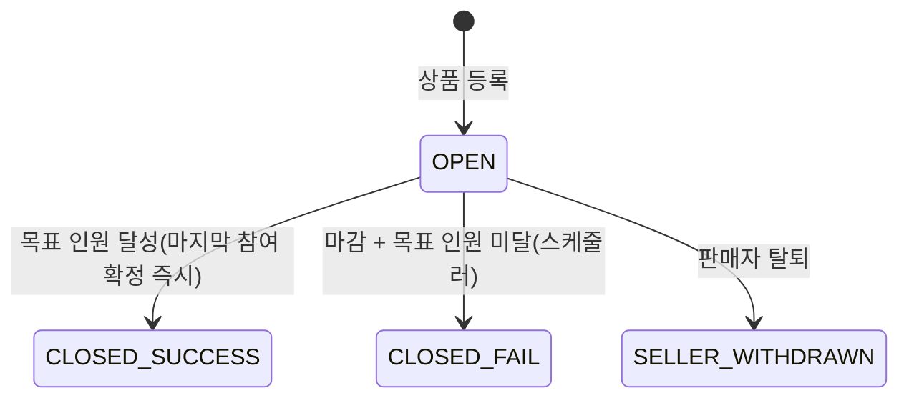
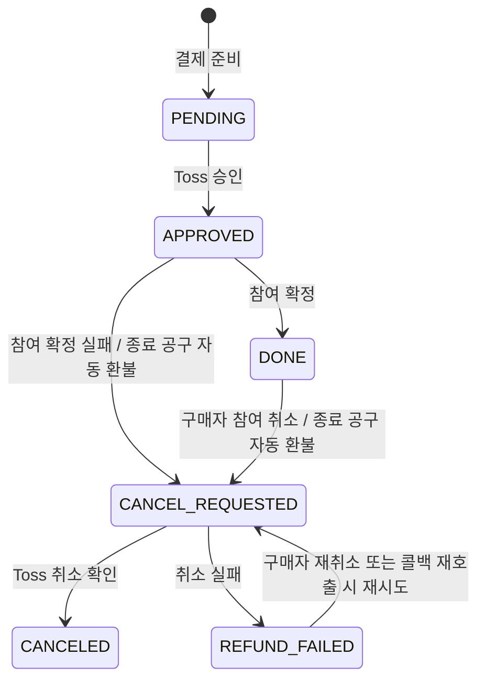
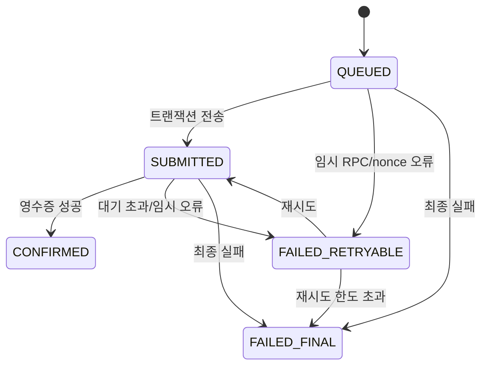
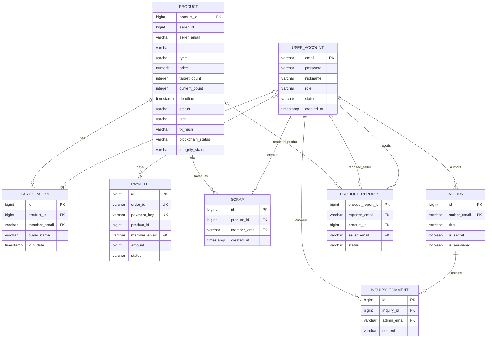
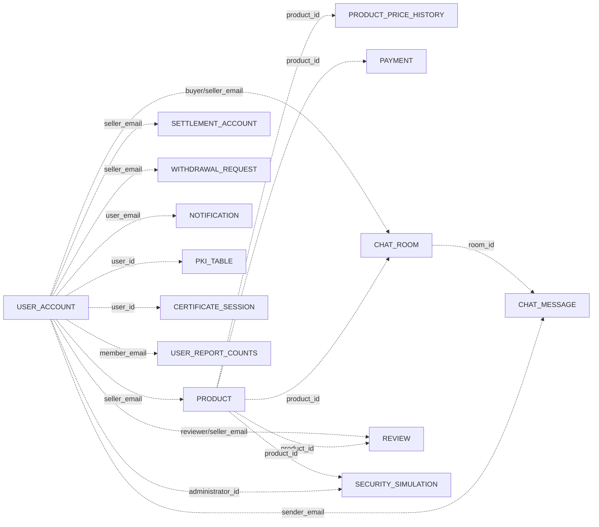

# 03. 설계 및 데이터베이스 모델링 (Design & Data Modeling)

- 문서 기준일: 2026-10-21
- 모델링 기준: 현재 `backend/src/main/java` JPA 엔티티 21개
- DB: Supabase PostgreSQL, Spring Data JPA, `ddl-auto=update`

> 이 문서는 미래 목표 스키마가 아니라 **현재 코드의 모델**을 설명한다. `GROUP_PURCHASE`와 `HISTORY` 테이블은 존재하지 않으며, 공동구매 상태는 `PRODUCT`, 결제 이력은 `PAYMENT`에 저장한다.

## 1. 역할·상태 설계

### 1.1 사용자 역할

| 역할 | 설명 | 핵심 기능 |
|---|---|---|
| `ROLE_BUYER` | 일반 구매자 | 상품 조회, 결제/참여/취소, 스크랩, 채팅, 후기, 문의/신고 |
| `ROLE_SELLER_PENDING` | 판매자 승인 대기 | 구매자 기능 유지, 판매 기능 제한 |
| `ROLE_SELLER` | 관리자가 승인한 판매자 | 상품 등록/수정/삭제, 참여자·주문 조회, 채팅, 분석, 정산/출금 |
| `ROLE_ADMIN` | 관리자 | 판매자 승인, 회원·상품·신고·출금·블록체인 작업 관리 |

관리자의 공동구매별 할인율 조정 기능과 판매자의 수동 발주 확정 단계는 현재 코드에 없다.

### 1.2 주요 상태 머신

#### 상품/공동구매

#### Toss 결제/참여

- 종료 공구 자동 환불: 상품 삭제·`CLOSED_FAIL`·`SELLER_WITHDRAWN` 상품의 결제를 `PaymentRefundScheduler`가 1분마다 환불한다.
- `REFUND_FAILED`는 자동 재시도하지 않는다.
- 환불 전 Toss 결제 상태를 조회해, 이미 취소된 건은 로컬 상태만 `CANCELED`로 맞춘다.

#### 블록체인 작업

## 2. 엔티티 카탈로그

| 도메인 | 테이블/엔티티 | 역할 | 주요 키·참조 |
|---|---|---|---|
| 인증 | `user_account` / `UserAccount` | 계정·역할·탈퇴 상태 | PK `email` |
| 인증 | `pki_table` / `DeviceCert` | CI hash, 기기 공개키, X.509 메타데이터 | PK `id`, UK `device_id`, `user_id`는 스칼라 참조 |
| 인증 | `certificate_session` / `CertificateSession` | 로그인 인증서 세션 수명 | PK `id`, UK `user_id` |
| 상품 | `product` / `Product` | 상품·공동구매·블록체인 상태 | PK `product_id`, `seller_email`은 FK 없음 |
| 상품 | `participation` / `Participation` | 구매자 참여 | FK `product_id`, nullable FK `member_email` |
| 상품 | `scrap` / `Scrap` | 구매자 스크랩 | FK `product_id`, FK `member_email` |
| 상품 | `product_price_history` / `ProductPriceHistory` | 가격 버전·변경 해시/트랜잭션 | `product_id`, `changed_by`는 FK 없음 |
| 결제 | `payment` / `Payment` | Toss 주문·승인·환불 상태 | UK `order_id`, UK `payment_key`, nullable FK `member_email`, `product_id`는 FK 없음 |
| 결제 | `settlement_account` / `SettlementAccount` | 판매자 정산 계좌 | UK `seller_email`, FK 없음 |
| 결제 | `withdrawal_request` / `WithdrawalRequest` | 판매자 출금 신청·관리자 처리 | `seller_email`은 FK 없음 |
| 채팅 | `chat_room` / `ChatRoom` | 상품 기반 구매자–판매자 1:1 방 | 이메일·`product_id`는 FK 없음 |
| 채팅 | `chat_message` / `ChatMessage` | 메시지·읽음·전송 취소 | `room_id`, `sender_email`은 FK 없음 |
| 알림 | `notification` / `Notification` | 사용자 알림·읽음 상태 | `user_email`은 FK 없음 |
| 후기 | `review` / `Review` | 거래 후기·감정 표시 | UK (`product_id`, `reviewer_email`), FK 없음 |
| 문의 | `inquiry` / `Inquiry` | 문의·공지·비공개/답변 상태 | FK `author_email` |
| 문의 | `inquiry_comment` / `InquiryComment` | 관리자 답변 | FK `inquiry_id`, FK `admin_email` |
| 신고 | `product_reports` / `ProductReport` | 상품/판매자 신고 | UK (`reporter_email`, `product_id`), 3개 FK |
| 신고 | `chat_reports` / `ChatReport` | 채팅 메시지 신고·관리자 처리 | UK (`reporter_email`, `message_id`), 3개 FK |
| 신고 | `user_report_counts` / `UserReportCount` | 게시물·채팅 신고 누적 | PK `member_email`, FK 없음 |
| 로그 | `system_log` / `SystemLog` | 보안·회원·상품 이벤트 로그 | PK `id` |
| 보안 | `security_simulation` / `SecuritySimulation` | 위변조·복구 시뮬레이션 스냅샷 | PK `simulation_id`, UK (`administrator_id`, `idempotency_key`) |

JPA FK가 없는 스칼라 참조는 서비스 로직이 일관성을 유지한다. 데이터베이스 수준의 참조 무결성·cascade를 자동 보장하지 않으므로, 물리 ERD와 논리 참조를 구분해야 한다.

## 3. 핵심 데이터 사전

### 3.1 `USER_ACCOUNT`

| 컬럼 | 타입 | 설명 |
|---|---|---|
| `email` | VARCHAR(100) | PK, 로그인 아이디 |
| `password` | VARCHAR | BCrypt 해시 |
| `nickname` | VARCHAR | 표시 닉네임 |
| `role` | VARCHAR | `ROLE_BUYER`, `ROLE_SELLER_PENDING`, `ROLE_SELLER`, `ROLE_ADMIN` |
| `status` | VARCHAR(20) | `ACTIVE`, `WITHDRAWN` |
| `created_at` | TIMESTAMP | 가입 시각 |

### 3.2 `PRODUCT`

| 컬럼 그룹 | 주요 컬럼 | 설명 |
|---|---|---|
| 식별/소유 | `product_id`, `seller_id`, `seller_email` | `seller_id`는 현재 임시 숫자값, 실사용 식별자는 `seller_email` |
| 상품 | `type`, `category`, `title`, `author`, `publisher`, `image_url`, `description` | `type`은 `BOOK` 또는 `ITEM` |
| 가격/도서 | `isbn`, `official_price`, `original_price`, `price`, `price_version` | 공식 정가·판매가·가격 버전 |
| 공동구매 | `target_count`, `current_count`, `deadline`, `status` | 별도 `GROUP_PURCHASE` 테이블 없음 |
| 블록체인 | `tx_hash`, `blockchain_status`, `blockchain_retry_count`, `blockchain_last_error`, `blockchain_updated_at`, `integrity_status` | 비동기 기록·재시도·무결성 상태 |
| 감사 | `created_at`, `updated_at` | 생성/수정 시각 |

`integrity_tampered`는 `@Transient`이며 DB 컬럼이 아니다.

### 3.3 `PARTICIPATION`

| 컬럼 | 설명 |
|---|---|
| `id` | PK |
| `product_id` | `PRODUCT` FK |
| `member_email` | `USER_ACCOUNT` nullable FK; 레거시 행 호환성을 위해 nullable |
| `buyer_name` | 참여 시점 닉네임 스냅샷 |
| `join_date` | 참여 시각 |

수량·결제상태·최종 금액은 `PARTICIPATION`에 저장하지 않는다. 현재 한 참여 행은 1명의 1회 참여를 표현하고, 결제 정보는 `PAYMENT`에 분리한다.

### 3.4 `PAYMENT`

| 컬럼 | 설명 |
|---|---|
| `id` | PK |
| `order_id` | Toss 주문 식별자, UK |
| `payment_key` | Toss 결제 키, nullable UK |
| `product_id` | 상품 논리 참조; DB FK 없음 |
| `member_email` | `USER_ACCOUNT` nullable FK |
| `buyer_name` | 결제 시점 닉네임 스냅샷 |
| `amount` | 서버가 상품 가격으로 계산한 결제 금액 |
| `status` | 결제/환불 상태 |
| `created_at`, `approved_at` | 준비/승인 시각 |
| `cancel_reason`, `cancel_requested_at`, `canceled_at` | 취소 사유·요청·확정 시각 |

### 3.5 `PKI_TABLE`

| 컬럼 | 설명 |
|---|---|
| `id` | PK |
| `user_id` | 계정 이메일의 논리 참조; JPA FK 없음 |
| `ci_hash` | CI HMAC-SHA256 결과 |
| `public_key` | 기기 RSA 공개키 |
| `device_id` | 기기 식별자, UK |
| `certificate_serial_number` | X.509 시리얼 |
| `revoked` | 폐기 여부 |
| `certificate_issued_at`, `certificate_expires_at` | 발급/만료 시각 |

## 4. 물리 FK 기준 ERD

`PRODUCT.seller_email`, `PAYMENT.product_id`, 채팅·후기·알림·가격 이력·정산·시뮬레이션의 식별자는 도메인 상 관련 행을 가리키지만 현재 JPA/DB FK는 아니다.

## 5. 논리 참조 지도

점선은 코드의 스칼라 ID/이메일 기반 **논리 참조**이며 물리 FK가 아니다.

## 6. 무결성·보안 설계 주의사항

- `ddl-auto=update`는 로컬/PoC에는 편리하지만 운영 스키마 변경 이력을 보장하지 않는다. 운영 전 Flyway/Liquibase 등 명시적 마이그레이션을 도입한다.
- 여러 스칼라 참조에 FK가 없어 고아 행이 생길 수 있다. 삭제/탈퇴 정책과 정기 무결성 점검이 필요하다.
- `seller_id`는 임시 숫자값과 `seller_email`이 병존한다. 레거시 이전 후 `seller_email` FK 또는 통합 회원 ID로 일원화한다.
- 계좌번호·개인식별·결제 메타데이터의 암호화, 마스킹, 보존/파기 기간을 별도 보안 정책으로 정의한다.
- 해시는 `BIGINT`가 아니라 SHA-256 16진 문자열로 다룬다.

## 7. 관련 문서

- [`01_Problem_Definition.md`](./01_Problem_Definition.md): 문제·범위
- [`02_Requirements.md`](./02_Requirements.md): 요구사항·인수 기준
- [`04_Architecture.md`](./04_Architecture.md): 시스템·배포 아키텍처
- [`05_Implementation.md`](./05_Implementation.md): 구현·형상 관리
