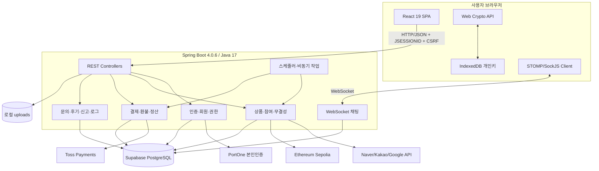
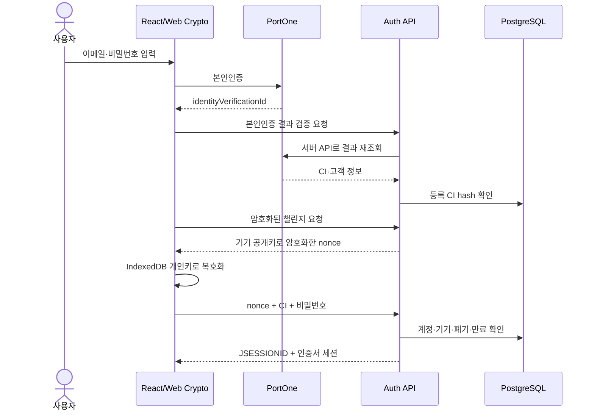
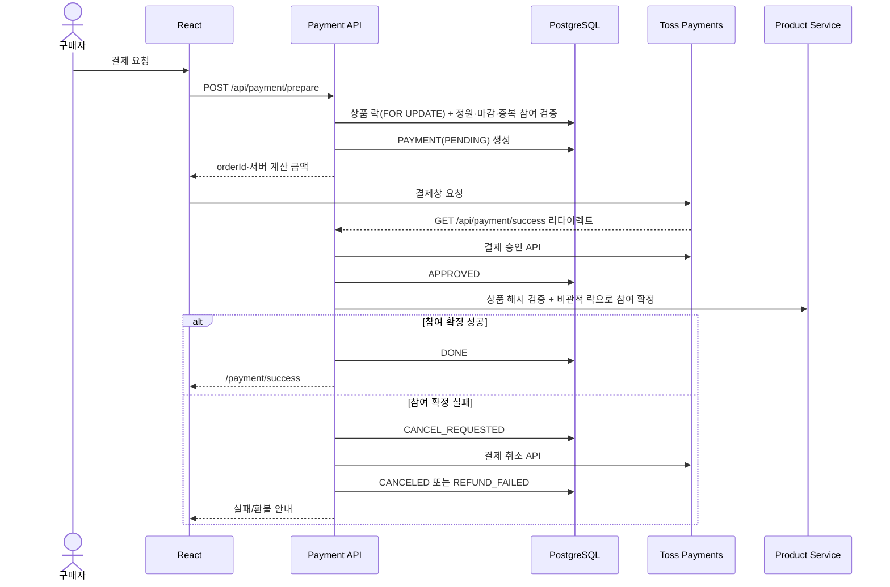

# 04. 시스템 아키텍처 및 배포 환경 (Architecture & Deployment)

- 문서 기준일: 2026-10-21
- 아키텍처 단계: 로컬/PoC 구현, 운영 배포 미완료

## 1. 전체 구조

N-bbang은 React SPA와 단일 Spring Boot 애플리케이션으로 구성된 기능 중심 계층형 모놀리스이다. PostgreSQL을 기본 저장소로 사용하고, 상품 핵심 데이터의 해시를 Ethereum Sepolia에 별도 기록한다.



## 2. 기술 스택

| 계층 | 기술 | 현재 용도 |
|---|---|---|
| 프런트엔드 | React 19.2.6, React Router DOM 6.30.1 | SPA, 역할별 라우팅, 세션 상태 |
| 스타일 | Tailwind CSS 3.4.19, PostCSS, 전역/페이지 CSS | 유틸리티 클래스와 자체 디자인 시스템 병용 |
| 실시간 클라이언트 | `@stomp/stompjs`, `sockjs-client` | 1:1 채팅·알림 |
| 프런트 빌드/테스트 | React Scripts 5, Jest, Testing Library | 빌드·컴포넌트 테스트 |
| 백엔드 | Java 17, Spring Boot 4.0.6 | 단일 애플리케이션 |
| HTTP | Spring MVC | 주 요청/응답 모델 |
| 외부 HTTP Client | Spring WebFlux `WebClient` | PortOne, Toss, 외부 검색 API 호출; 서버 전체는 반응형이 아님 |
| 데이터 | Spring Data JPA, PostgreSQL | Supabase PostgreSQL 영속화 |
| 보안 | Spring Security, BCrypt, CSRF, HTTP Session, MVC Interceptor | 비밀번호·세션·요청 위조 방어·역할 인가 |
| PKI | Web Crypto API, BouncyCastle, X.509, RSA-OAEP | 본인 CI에 연결된 기기 개인키 보유 증명 |
| 블록체인 | Web3j 4.10.0, Solidity, Sepolia | 상품 ID·ISBN·가격 해시 기록/조회 |

MySQL 드라이버도 의존성에 존재하지만, 현재 활성 `local` 프로필은 PostgreSQL/Supabase를 사용한다.

## 3. 백엔드 컴포넌트

| 도메인 | 주요 책임 |
|---|---|
| `auth`, `member` | PortOne CI 본인인증, 회원가입, X.509 발급, RSA-OAEP 챌린지, 로그인/로그아웃, 인증서 세션 |
| `product`, `search` | 상품 CRUD, 참여/취소, 스크랩, 가격 이력, 외부 검색, 해시 생성, Sepolia 기록/검증 |
| `payment` | Toss 결제 준비·승인·조회·취소, 환불 보상 트랜잭션, 정산 계좌/출금 |
| `chat`, `notification` | STOMP/SockJS 채팅, 채팅방 수명주기, 안 읽은 수, 알림 |
| `review`, `inquiry`, `report` | 후기, 문의/답변, 상품·채팅 신고 |
| `admin`, `analytics`, `log` | 판매자 승인, 통계, 상품/출금/신고 관리, 보안 로그, 시뮬레이션, 레거시 해시 마이그레이션 |

이 컴포넌트들은 도메인별 패키지로 나뉘어 있지만 개별 배포되는 마이크로서비스가 아니다. 같은 프로세스·DB·트랜잭션 경계를 공유한다.

## 4. 인증·요청 보안 흐름



### HTTP 보안 계층

- Spring Security는 BCrypt, CORS, CSRF, Session 정책을 제공한다.
- 실제 API 로그인 여부는 `AuthInterceptor`가 `/api/**`에 기본 차단+화이트리스트를 적용한다.
- `/api/admin/**`는 `AdminAuthInterceptor`가 `ROLE_ADMIN`을 추가로 확인한다.
- Spring Security 인증 객체를 사용하지 않기 때문에 HTTP 인가 설정은 `permitAll`이며, 세션 인가는 MVC 인터셉터에서 수행한다.
- SPA는 `/api/csrf`에서 받은 쿠키/헤더 토큰을 상태 변경 요청에 전송한다.

### PKI 한계

- 현재 로그인은 전자서명 검증이 아니라 RSA-OAEP 암호화 nonce 복호화로 개인키 보유를 확인한다.
- 개인키는 IndexedDB에 저장되며 하드웨어 보안 영역에 귀속되지 않는다.
- Root CA 키와 폐기 목록은 메모리 기반이므로 재시작 후 유지되지 않는 PoC 구조이다.

## 5. 결제 아키텍처

PortOne은 본인인증, Toss Payments는 실제 결제를 담당한다. 현재 결제 확정은 PortOne 웹훅이 아니라 Toss 리다이렉트 성공 콜백을 사용한다.



응답 유실·중복 요청에 대비해 Toss의 실제 주문 상태를 재조회한다. 성공 콜백이 다시 호출되면 저장된 결제 상태부터 이어서 처리한다.

- Toss 호출 타임아웃: 연결 3초, 응답 10초
- 구매자 참여 취소: 상품 락 안에서 `CANCEL_REQUESTED`를 선점하고, 락 밖에서 Toss 환불 후 참여·인원을 정리한다.
- 종료 공구 자동 환불: `PaymentRefundScheduler`가 1분마다 상품 삭제·모집 실패(`CLOSED_FAIL`)·판매자 탈퇴(`SELLER_WITHDRAWN`) 공구의 미환불 결제(`DONE`, 10분 이상 지난 `APPROVED`·`CANCEL_REQUESTED`)를 환불한다.
- 모집 중 상품에서 멈춘 `CANCEL_REQUESTED`와 `REFUND_FAILED`는 스케줄러가 처리하지 않으며, 구매자 재취소 또는 콜백 재호출로 재시도한다.

## 6. 블록체인 무결성 아키텍처

### 6.1 기록/검증 범위

```text
DB 현재값: productId + ISBN + price
                    │ SHA-256
                    ▼
              expectedHash
                    │ compare
                    ▼
Sepolia PriceVerification.productHashes(productId)
```

- 상품 등록 트랜잭션이 DB에 커밋된 뒤 `@Async`로 해시 기록을 시작한다.
- 트랜잭션 전송과 영수증 확정을 분리하고 nonce 충돌, txpool, RPC 네트워크 오류를 분류해 재시도한다.
- 구매자 상품 상세에서 별도 검증 API를 호출해 DB 해시와 온체인 해시를 비교한다.
- 공식 정가 비교는 블록체인 무결성 비교와 다른 보조 판단이다.
- Toss 결제 데이터는 해시 항목에 포함되지 않으며, DB–Toss–블록체인 3중 결제 검증이 아니다.

### 6.2 현재 한계

`PriceVerification.recordHash` 함수는 공개 함수이며 호출자 권한 검사가 없고, 동일 `productId`의 현재 mapping 값을 덮어쓴다. 이벤트/트랜잭션 이력은 체인에 남지만 현재 조회값 자체를 불변으로 보장하지 않는다. 운영 전에 소유자/역할 제한과 append-only 버전 정책을 적용해야 한다.

Sepolia는 애플리케이션·스마트 컨트랙트 개발의 기본 권장 테스트넷이므로 PoC 선택은 타당하다. 다만 네트워크 성능을 “완벽하다”고 단정하지 않고 실측 지표로 판단한다. ([Ethereum.org Networks](https://ethereum.org/developers/docs/networks/))

## 7. 배포 아키텍처

### 7.1 현재 확인된 구성

| 항목 | 현재 상태 |
|---|---|
| 프런트 정적 배포 | `gh-pages -d build` 스크립트 존재 |
| 프런트 API 주소 | 다수가 `http://localhost:8080`에 고정 |
| 백엔드 CORS | `http://localhost:3000`만 허용 |
| 데이터베이스 | 로컬 프로필에서 Supabase PostgreSQL 연결 |
| 파일 저장 | 백엔드 프로세스의 로컬 `uploads` 디렉터리 |
| CI/CD | `.github/workflows` 없음 |
| 컨테이너/IaC | Dockerfile, Compose, Terraform 등 없음 |
| HTTPS/역방향 프록시 | 저장소 구성 없음 |
| AWS 백엔드 배포 | 저장소에서 확인 불가 |

따라서 현재 저장소는 로컬 시연·PoC 구성으로 본다. GitHub Pages 스크립트만으로는 백엔드·WebSocket·로컬 업로드를 포함한 완전한 서비스를 배포할 수 없다.

### 7.2 목표 배포 구성

```mermaid
flowchart TB
    U[사용자] -->|HTTPS| CDN[Static Hosting / CDN]
    U -->|HTTPS + WSS| RP[Reverse Proxy / Load Balancer]
    CDN --> SPA[React Build]
    RP --> API[Spring Boot]
    API --> DB[(Supabase PostgreSQL)]
    API --> OBJ[(Object Storage)]
    API --> EXT[PortOne / Toss / Book APIs]
    API --> ETH[Sepolia RPC]
    CI[GitHub Actions] -->|test/build/deploy| CDN
    CI -->|test/build/deploy| API
    SM[Secret Manager] --> API
    MON[Logs / Metrics / Alerts] <-- API
```

목표 구성은 계획이며 아직 구현 완료로 표기하지 않는다.

### 7.3 운영 전 필수 조치

1. 프런트/API/WebSocket 주소를 환경 변수로 일원화한다.
2. 운영 도메인 HTTPS/WSS와 CORS 허용 목록을 설정한다.
3. DB 비밀번호, 결제 키, RPC 키, 블록체인 개인키를 재발급하고 Secret Manager로 이전한다.
4. 로컬 업로드를 영속 Object Storage로 이전한다.
5. DB 마이그레이션, 백업, 복구, 로그 마스킹, 모니터링을 구성한다.
6. GitHub Actions에 프런트/백엔드 테스트, 시크릿 스캔, 빌드, 배포 승인 단계를 추가한다.
7. PortOne/Toss의 운영 인증·리다이렉트·웹훅 보안은 각 공식 정책을 기준으로 별도 설계한다.

## 8. 검증 현황

- 블록체인 기록·조회·재시도를 다루는 서비스/테스트 코드가 있다.
- 비관적 락은 `ProductRepository.findByIdForUpdate` 및 결제/참여 서비스에서 사용한다.
- 2026-10-21 수동 실행에서 프런트 테스트는 33개 중 32개가 통과했고, `App.test.js`의 이전 브랜드명 기대값 1개가 실패했다.
- 백엔드 테스트는 Gradle 배포본 다운로드 중 연결 재설정으로 실행을 완료하지 못했다. 코드 실패로 판정하지 않지만 “전체 통과”로도 표기하지 않는다.

## 9. 관련 문서

- [`01_Problem_Definition.md`](./01_Problem_Definition.md): 문제·범위·KPI
- [`02_Requirements.md`](./02_Requirements.md): 기능·비기능 요구사항
- [`03_Design.md`](./03_Design.md): 데이터·상태 설계
- [`05_Implementation.md`](./05_Implementation.md): 구현·형상 관리
